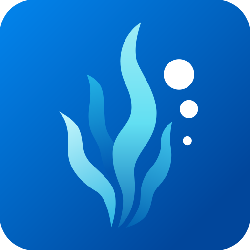
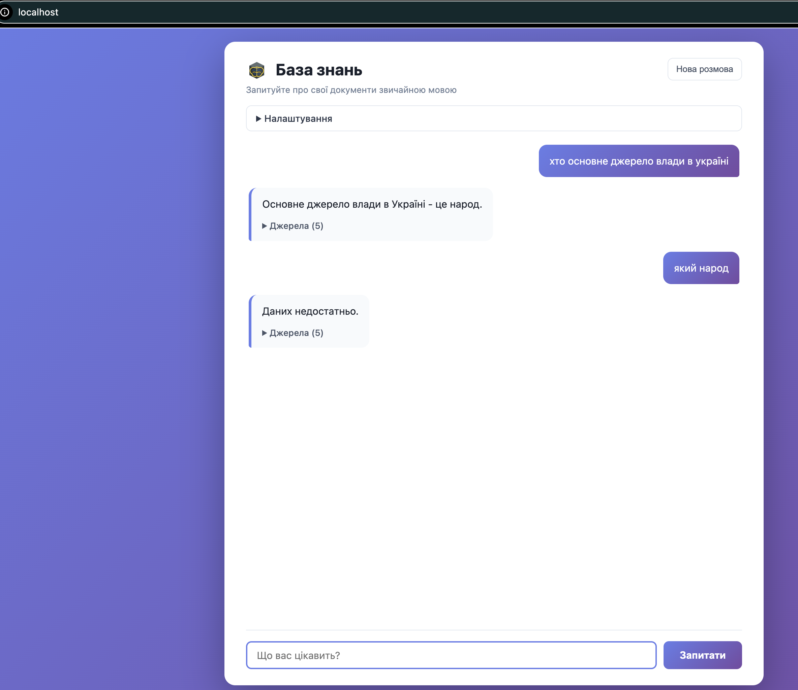

# basaltrock-ua

[](LICENSE)
[-blue?logo=docker)](https://www.docker.com/)
[](Makefile)
<a href="https://github.com/seaweedfs/seaweedfs"></a>
[](https://github.com/seaweedfs/seaweedfs)

Україномовна база знань з ШІ. Складіть свої документи в одну теку — і запитуйте їх звичайною мовою.

Усе працює на вашому компʼютері. Документи нікуди не надсилаються, інтернет потрібен лише для першого завантаження.



Українська локалізація
[basaltrock-private-cloud](https://github.com/bohdanartiushenko/basaltrock-private-cloud):
інтерфейс, системна інструкція та кодування `cp1251` для старих `.doc`. Усю
механіку стека тримає той репозиторій і підтягується автоматично.

## Що потрібно

[Docker Desktop](https://www.docker.com/products/docker-desktop/) — встановити й запустити.
Gnu make, Linux / MacOS / Windows + Linux tools.

### Системні вимоги

| Компонент | RAM | GPU VRAM | Диск |
|-----------|-----|----------|------|
| OpenSearch 2.11.0 | 1.0 GB | — | ~2.2 GB (образ + індекси) |
| SeaweedFS 4.48 (сховище документів) | 20MB | — | образ + копія ваших документів |
| `ai/gemma3:4b-q4_K_M` (чат) | 29 MB | ~3.5 GB | 3.34 GB |
| `ai/nomic-embed-text-v2-moe` (вектори) | 29 MB | 560 MB | 913 MB |
| API + індексація | ~460 MB | — | ~690 MB |
| **Разом** | **~1.5 GB** | **~4.1 GB** | **~7.2 GB** |

## Як користуватися

Покладіть документи в теку `data`, потім у терміналі:

```bash
make up
```

Перший запуск триває кілька хвилин — завантажуються моделі та індексуються документи.

Коли побачите `Ready`, відкрийте **http://localhost** і запитуйте.

Щоб зупинити:

```bash
make down
```

Додали або змінили документи — `make ingest`. Індекс зберігається між `make down`
і `make up`; видаляє його лише `make prune`.

### Додавання папки з документами

```bash
make store sync ./archive store://archive
make ingest
```

## Підтримувані формати файлів документів

`.txt`, `.md`, `.pdf`, `.doc`, `.docx`, `.xls`, `.xlsx`, `.csv`, `.html`


## Налаштування

- `system-prompt.ua.txt` — системна інструкція. Підтримує `{context}`, `{history}`,
  `{question}`; подробиці у
  [basaltrock-private-cloud](https://github.com/bohdanartiushenko/basaltrock-private-cloud#system-prompt).
- `index.ua.html` — інтерфейс українською.
- Решта параметрів (`DATA_FOLDER`, `MODEL_RUNNER_LLM_CHAT`, …) — з
  private-cloud, перевизначайте у `make` або в `Makefile`.

## Ліцензія

MIT. Працює на основі [basaltrock](https://github.com/bohdanartiushenko/basaltrock)
та [basaltrock-private-cloud](https://github.com/bohdanartiushenko/basaltrock-private-cloud).